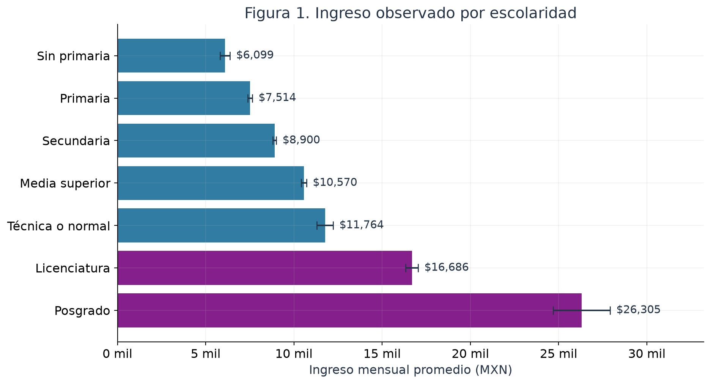

# Educación e ingresos en México

Análisis reproducible de la relación entre escolaridad e ingreso del trabajo principal
con microdatos de la **ENIGH 2024 del INEGI**.

## Qué exploro

¿Cuánto difieren los ingresos entre niveles educativos? ¿La relación se mantiene al
considerar edad, jornada, sexo y ubicación? Me interesa comparar las diferencias
observadas con las que permanecen al incorporar otros factores, y evaluar qué tan
útil resulta esa información para predecir ingresos en personas reservadas.

El proyecto reúne preparación de datos, análisis exploratorio, regresión ponderada,
inferencia que contempla el diseño de encuesta y validación predictiva. Las diferencias
estimadas son **asociaciones**, no efectos causales ni garantías de ingreso individual.

## Resultados principales

| Indicador | Resultado |
|---|---:|
| Personas en la muestra analítica | 76,407 |
| Diferencia de licenciatura frente a secundaria, considerando controles | +94.1% |
| IC95% de esa diferencia | 90.2% a 98.1% |
| R² ponderado del modelo ajustado en log ingreso | 0.392 |
| Error absoluto medio ponderado en prueba | $5,181 MXN |
| Reducción del error frente a predecir la media de entrenamiento | 19.4% |

La diferencia porcentual compara **medias geométricas condicionales**. No representa
directamente una diferencia de medias aritméticas ni el aumento que una persona
obtendría al estudiar. La evaluación reserva UPM completas y es interna a esta encuesta.



## Explorar el proyecto

- [Notebook ejecutado](notebooks/01_educacion_ingresos_enigh2024.ipynb): preparación,
  decisiones metodológicas, resultados, diagnósticos e interpretación.
- [Síntesis del análisis](reports/sintesis_resultados.md).
- [Informe HTML](reports/analisis_educacion_ingresos.html): descargar y abrir localmente
  para consultar los resultados sin instalar Python.
- [Resumen visual en PDF](visuals/resumen_educacion_ingresos.pdf) y
  [PNG](visuals/resumen_educacion_ingresos.png).
- [Código del análisis](src/analysis.py) y [pruebas](tests/test_analysis.py).

## Datos y alcance

Se usan las tablas **Población**, **Ingresos** y **Trabajos**. La descarga conserva
los ZIP originales y registra enlaces, tamaños y huellas SHA-256 en
`data/source_manifest.json`. Las uniones usan los identificadores como texto.

La población analizada se delimita a integrantes del hogar de **25 a 64 años**, con
**un solo trabajo subordinado remunerado en México**, ingreso positivo y jornada de
1 a 168 horas semanales. La tabla original contiene 308,598 personas; los filtros
y exclusiones están en `outputs/tables/auditoria_muestra.csv`.

La respuesta suma `ing_tri` de las claves **P001-P007** y divide entre tres:
ingreso monetario corriente mensualizado del trabajo principal. Incluye sueldo,
comisiones, horas extra, incentivos, bonos y primas. Excluye pagos anuales del ejercicio
2023, otros trabajos, negocios y transferencias; no es ingreso total del hogar.

Escolaridad indica el máximo nivel con grados aprobados y puede estar incompleto.
Técnica y normal se conservan en un grupo separado; no se inventan años equivalentes.

## Enfoque

1. Auditoría de las fuentes, uniones por persona y delimitación explícita de la muestra.
2. Distribuciones y medias ponderadas por escolaridad, con intervalos para la media.
3. Comparación de escolaridad sola con un modelo ajustado por edad centrada, su cuadrado,
   log horas, sexo, ámbito rural y entidad. Ocupación se incorpora como sensibilidad.
4. Estimación ponderada en log ingreso; covarianza de Taylor por UPM y estrato, con el
   marco completo y scores cero fuera del dominio. Aproximación con reemplazo, sin
   corrección de población finita. Los pesos no se interpretan como precisiones.
5. Validación reservando UPM completas con semilla 2026. Coeficientes y factor de Duan
   se estiman exclusivamente en entrenamiento; se reportan MAE, RMSE y R² en su escala.
6. Diagnósticos exploratorios OLS y sensibilidad sin el 1% superior, manteniendo la
   muestra completa en el modelo principal.

La edad no equivale a experiencia. No se observan todas las diferencias de habilidad,
historia familiar, calidad educativa o selección al empleo. La corrección global de
Duan puede ser insuficiente con heterocedasticidad. Los diagnósticos clásicos OLS
no incorporan el diseño de encuesta; sus valores p no sustituyen la inferencia Taylor.
Los resultados son elaboración propia, no tabulados oficiales del INEGI.

## Ejecutar localmente

Entorno utilizado: **Python 3.12**. Abrir esta carpeta en VS Code con las extensiones
Python y Jupyter. El notebook conserva sus salidas; para volver a ejecutarlo hay que
crear el entorno y seleccionar su intérprete como kernel.

En PowerShell, desde la raíz del proyecto:

```powershell
py -3.12 -m venv .venv
.venv\Scripts\python.exe -m pip install -r requirements-lock.txt
.venv\Scripts\python.exe scripts/download_data.py
.venv\Scripts\python.exe scripts/build_notebook.py
.venv\Scripts\python.exe scripts/build_visual_summary.py
.venv\Scripts\python.exe -m unittest discover -s tests -v
```

El constructor del notebook ejecuta también el análisis. Para ejecutar solo el análisis:

```powershell
.venv\Scripts\python.exe -m src.analysis
```

Para exportar la imagen del resumen desde el PDF se utiliza Poppler, con `pdftoppm`
accesible en el sistema:

```powershell
pdftoppm -scale-to 4800 -singlefile -png visuals/resumen_educacion_ingresos.pdf visuals/resumen_educacion_ingresos
```

La descarga requiere Internet; las operaciones posteriores son locales. No se ejecuta
contenido descargado. `requirements-lock.txt` fija las dependencias directas utilizadas;
`requirements.txt` ofrece rangos y `outputs/entorno.json` registra las versiones principales.

## Estructura

```text
data/           Manifiesto de fuentes y datos locales excluidos de Git
notebooks/      Análisis ejecutado
src/            Preparación, estimación, validación y gráficas
scripts/        Descarga y generación de resultados
tests/          Comprobaciones de varianza, pesos e integridad
outputs/        Tablas, figuras y resultados
reports/        Informe y síntesis
visuals/        Resumen de una página y metadatos de sus cifras
```

Los microdatos originales, la muestra procesada y el entorno no se incluyen en Git ni
en el ZIP. Pueden recuperarse y generarse con los scripts. Las pruebas contrastan la
varianza estratificada, la inclusión de UPM fuera del dominio, la invariancia al cambio
de escala de los pesos y la consistencia de los resultados.

## Fuentes

Instituto Nacional de Estadística y Geografía. (2025). *Encuesta Nacional de Ingresos y
Gastos de los Hogares 2024, Nueva Serie* [Microdatos].
https://www.inegi.org.mx/programas/enigh/nc/2024/

INEGI. (2025). *ENIGH 2024: Descripción de la base de datos*.
https://www.inegi.org.mx/contenidos/programas/enigh/nc/2024/microdatos/889463924494.pdf

INEGI. (2025). *ENIGH 2024: Diseño muestral*.
https://www.inegi.org.mx/contenidos/programas/enigh/nc/2024/doc/889463924517.pdf

Duan, N. (1983). Smearing estimate: A nonparametric retransformation method.
*Journal of the American Statistical Association, 78*(383), 605-610.
https://doi.org/10.1080/01621459.1983.10478017

## Autoría y licencia

Luis David Gonzalez Romero y Diego Alberto Ortega Carreto.

El código propio se distribuye bajo MIT. Los datos y documentos conservan las
[condiciones del INEGI](https://www.inegi.org.mx/inegi/terminos.html).
El proyecto no implica afiliación ni aval del INEGI.
